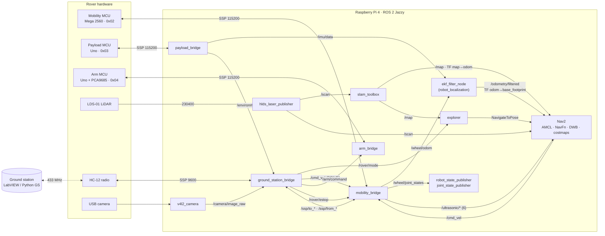

# MISSION X Rover — ROS 2 (Jazzy) software stack

The 2023 rover ran ROS 1 Noetic on the Raspberry Pi 4: LDS-01 LiDAR +
`hector_slam` for mapping, `map_server` + `amcl` + `move_base`/DWA for
navigation, `rosserial` for the Arduino sensor topics and
`teleop_twist_keyboard`. That source code was lost. This workspace rebuilds the
stack for **ROS 2 Jazzy Jalisco on Ubuntu 24.04**, reuses the pure-Python
protocol library `rover_core` (ICD v2.0), and adds a simulator so that SLAM,
navigation and exploration can be developed and evaluated without the rover.

Interfaces (serial protocol, addresses, payloads, physical parameters, topic
table) are normative in [`docs/ICD.md`](ICD.md). This document describes the
ROS 2 side.

## 1. Packages (`ros2_ws/src`)

| Package | Type | Content |
|---------|------|---------|
| `rover_core` | ament_python | SSP framing (`ssp`), packet types / payloads (`protocol`), parameters (`params`), skid-steer kinematics + wheel odometry (`kinematics`), 2.5-D simulator (`sim`). ROS-free. |
| `rover_interfaces` | ament_cmake | `EnvironmentTelemetry.msg`, `ArmCommand.msg` (pose constants), `RoverStatus.msg`, `SetMode.srv` |
| `rover_description` | ament_cmake | xacro URDF (rocker-bogie with mimic differential, 6 driven + 6 twin wheels, WEB, 30° solar panel, LiDAR mast, IMU, camera, 6 ultrasonic frames), `display.launch.py`, RViz config |
| `rover_hardware` | ament_python | `mobility_bridge`, `payload_bridge`, `arm_bridge`, `ground_station_bridge` (pyserial + `rover_core`); ROS-free `conversions`, `serial_link`, `ground_station_core` with pytest suites |
| `rover_sim` | ament_python | `rover_sim_node` (wraps `rover_core.sim`), `worlds/lab.yaml` + `lab.pgm`, world generator script |
| `rover_slam` | ament_cmake | slam_toolbox online-async configuration for the LDS-01, `slam.launch.py` |
| `rover_navigation` | ament_cmake | Nav2 parameters (AMCL, NavFn, DWB, costmaps with LiDAR **and ultrasonic** layers), `navigation.launch.py`, `maps/lab.yaml` |
| `rover_bringup` | ament_cmake | `robot.launch.py`, `sim.launch.py`, `ground_station.launch.py`, `teleop.launch.py`, `description.launch.py`, `config/ekf.yaml`, udev rules, RViz config |
| `rover_mission` | ament_python | `explorer` (frontier exploration with Nav2), ROS-free `frontiers` module with pytest suite |

## 2. Architecture



In simulation, `rover_sim_node` takes the place of the three MCUs **and** the
LiDAR (it publishes `/scan`, `/wheel/odom`, `/imu/data`, `/ultrasonic/*`,
`/wheel/joint_states` and `/clock` and consumes `/cmd_vel`), so the EKF,
slam_toolbox, Nav2 and the explorer run unchanged.

### 2.1 Topics, services and actions

| Name | Type | Producer → consumer | QoS |
|------|------|---------------------|-----|
| `/cmd_vel` | geometry_msgs/Twist (TwistStamped with `use_stamped_cmd_vel`) | Nav2 velocity_smoother, teleop, GS DRIVE → mobility_bridge / rover_sim | reliable |
| `/wheel/odom` | nav_msgs/Odometry (`odom` → `base_footprint`) | mobility_bridge / rover_sim → EKF | reliable |
| `/wheel/joint_states` | sensor_msgs/JointState (6 wheel joints) | mobility_bridge / rover_sim → joint_state_publisher | reliable |
| `/odometry/filtered` | nav_msgs/Odometry | EKF → Nav2, GS bridge | reliable |
| `/imu/data` | sensor_msgs/Imu (`imu_link`, roll/pitch only) | payload_bridge / rover_sim → EKF, GS bridge | reliable |
| `/ultrasonic/{front_left,front_center,front_right,left,right,rear}` | sensor_msgs/Range (`us_<name>_link`, FOV 15°, 0.02–4 m, `+inf` = no echo) | mobility_bridge / rover_sim → costmap `range_layer`, GS bridge | reliable |
| `/scan` | sensor_msgs/LaserScan (`laser_link`, 360 beams) | hls_lfcd_lds_driver / rover_sim → slam_toolbox, AMCL, costmaps | **best effort** (sim) |
| `/map` | nav_msgs/OccupancyGrid | slam_toolbox or map_server → Nav2, explorer | transient local |
| `/environment` | rover_interfaces/EnvironmentTelemetry | payload_bridge → GS bridge | reliable |
| `/environment/{temperature,humidity,pressure}` | sensor_msgs/Temperature, RelativeHumidity, FluidPressure | payload_bridge | reliable |
| `/rover/status` | rover_interfaces/RoverStatus (HEARTBEAT, `source` = MCU address) | MCU bridges → GS bridge | reliable |
| `/rover/mode` | std_msgs/UInt8 (0 IDLE, 1 TELEOP, 2 AUTONOMOUS, 3 SAFE) | ground_station_bridge → explorer | transient local, re-published 1 Hz |
| `/rover/set_mode` (service) | rover_interfaces/SetMode | any → ground_station_bridge | — |
| `/rover/estop` | std_msgs/Bool (true = engage) | GS bridge, operator → mobility_bridge, rover_sim | reliable |
| `/mobility_bridge/estop`, `/mobility_bridge/clear_estop` (services) | std_srvs/Trigger | operator → mobility_bridge | — |
| `/arm/command` | rover_interfaces/ArmCommand | GS bridge (COLLECT_OBJECT), operator → arm_bridge | reliable |
| `/arm/joint_states`, `/arm/moving` | sensor_msgs/JointState, std_msgs/Bool | arm_bridge | reliable |
| `/ssp/to_{mobility,payload,arm}`, `/ssp/from_{…}` | std_msgs/UInt8MultiArray (raw SSP frames) | GS bridge ↔ MCU bridges (ICD §5 routing) | reliable |
| `/navigate_to_pose` (action) | nav2_msgs/action/NavigateToPose | explorer, RViz → Nav2 | — |
| `/explorer/status`, `/explorer/goal`, `/explorer/frontiers` | String, PoseStamped, MarkerArray | explorer | — |
| `/ground_truth/odom`, `/sim/collisions`, `/clock` | Odometry (`world` frame), UInt32, Clock | rover_sim | reliable |
| `/camera/image_raw` | sensor_msgs/Image | v4l2_camera → GS bridge (CAP_IMAGE) | sensor data |

### 2.2 Frames (REP-103 / REP-105)

```
world ─(static, sim only: start pose)─ map ─(slam_toolbox | AMCL)─ odom ─(EKF)─ base_footprint
base_footprint ── base_link (z = wheel radius)
   base_link ── chassis_link, solar_panel_link, lidar_mast_link, laser_link (z ≈ 0.62 m above ground),
                imu_link, camera_link ── camera_optical_link, arm_base_link,
                us_{front_left,front_center,front_right,left,right,rear}_link (ICD §9.3),
                left/right_rocker_link ── left/right_bogie_link ── *_wheel_link ── *_twin_wheel_link
```

The EKF publishes `odom → base_footprint` (the ICD §10 table says
`odom → base_link`; `base_link` is a fixed child of `base_footprint`, so all
consumers see the same chain). The mobility bridge can publish the same TF from
wheel odometry alone (`publish_tf:=true`) when the EKF is not running.
Maps made by slam_toolbox and by `make_lab_world.py` share the convention
**map frame = rover start pose**, so AMCL starts at (0, 0, 0).

## 3. Raspberry Pi 4 installation (Ubuntu 24.04 + Jazzy)

1. Flash **Ubuntu Server 24.04 LTS (64-bit, arm64)**, enable SSH, then
   install ROS 2 Jazzy following <https://docs.ros.org/en/jazzy/Installation/Ubuntu-Install-Debs.html>
   (`ros-jazzy-ros-base` is enough on the rover; RViz runs on the laptop).
2. Packages:
   ```bash
   sudo apt install -y \
     ros-jazzy-ros-base ros-dev-tools python3-colcon-common-extensions python3-rosdep \
     ros-jazzy-navigation2 ros-jazzy-nav2-bringup ros-jazzy-slam-toolbox \
     ros-jazzy-robot-localization ros-jazzy-xacro ros-jazzy-robot-state-publisher \
     ros-jazzy-joint-state-publisher ros-jazzy-teleop-twist-keyboard \
     ros-jazzy-hls-lfcd-lds-driver ros-jazzy-v4l2-camera ros-jazzy-cv-bridge \
     python3-serial python3-numpy python3-yaml python3-opencv python3-pytest
   # laptop / ground PC only: ros-jazzy-desktop (RViz) and ros-jazzy-joint-state-publisher-gui
   ```
3. Serial devices: install the udev rules (fill in the serial numbers first,
   instructions inside the file) and join the `dialout` group:
   ```bash
   sudo cp ros2_ws/src/rover_bringup/config/99-missionx-rover.rules /etc/udev/rules.d/
   sudo udevadm control --reload-rules && sudo udevadm trigger
   sudo usermod -aG dialout $USER     # log out / in
   ls -l /dev/rover_*                 # mobility payload arm lidar radio
   ```
4. Build:
   ```bash
   cd ~/MissionX-Rover/ros2_ws
   source /opt/ros/jazzy/setup.bash
   sudo rosdep init 2>/dev/null; rosdep update
   rosdep install --from-paths src --ignore-src -r -y
   colcon build --symlink-install
   source install/setup.bash          # add to ~/.bashrc
   ```
   Optional: run `ros2 launch rover_bringup robot.launch.py` from a systemd
   unit so the rover comes up at boot.
5. Networking: rover and laptop on the same Wi-Fi with the same
   `ROS_DOMAIN_ID` (e.g. `export ROS_DOMAIN_ID=42`).

## 4. Running

### 4.1 Real rover
```bash
ros2 launch rover_bringup robot.launch.py                       # drivers, bridges, EKF, GS bridge
ros2 launch rover_bringup robot.launch.py camera:=true          # + /camera/image_raw for CAP_IMAGE
ros2 launch rover_bringup teleop.launch.py                      # (or ros2 run teleop_twist_keyboard ...)
```
Arguments: `mobility_port`, `payload_port`, `arm_port`, `radio_port`,
`lidar_port`, `lidar`, `ground_station`, `camera`, `slam`, `nav`, `explore`,
`map`, `xacro_args`, `hardware_params`, `ekf_params`.

### 4.2 Simulator
```bash
ros2 launch rover_bringup sim.launch.py                           # sim + EKF + RSP + RViz
ros2 launch rover_bringup sim.launch.py slam:=true                # map the lab with teleop
ros2 run teleop_twist_keyboard teleop_twist_keyboard --ros-args -p use_sim_time:=true
ros2 launch rover_bringup sim.launch.py nav:=true                 # AMCL on maps/lab.yaml + Nav2
ros2 launch rover_bringup sim.launch.py slam:=true nav:=true explore:=true explore_autostart:=true
```
`world:=<file>` selects another world (`""` = `World.default_lab()`),
`real_time_factor:=2.0` runs faster than real time, `seed:=N` changes the noise.
The lab world (`rover_sim/worlds/lab.yaml`, ~10 m × 7 m) contains benches, a
cupboard, a pillar, chairs (0.45 m seats with thin backrests) and **low crates
and a rock (0.12–0.28 m) that the 0.62 m LiDAR cannot see**; regenerate it and
the LiDAR-visible Nav2 map with
`PYTHONPATH=ros2_ws/src/rover_core python3 ros2_ws/src/rover_sim/scripts/make_lab_world.py`.
`/sim/collisions` counts body collisions — the metric for the ultrasonic layer.

### 4.3 SLAM
```bash
ros2 launch rover_slam slam.launch.py [use_sim_time:=true]
ros2 run nav2_map_server map_saver_cli -f ~/maps/lab           # writes lab.yaml + lab.pgm
```

### 4.4 Navigation
```bash
ros2 launch rover_navigation navigation.launch.py map:=$HOME/maps/lab.yaml      # AMCL + Nav2
ros2 launch rover_navigation navigation.launch.py localization:=false           # with SLAM
```
Set the initial pose / goals with the RViz *2D Pose Estimate* / *2D Goal Pose*
tools (`rover_bringup/rviz/rover_nav.rviz`). The command chain is
`controller_server → /cmd_vel_nav → velocity_smoother → /cmd_vel`.

Low obstacles: both costmaps contain `nav2_costmap_2d::RangeSensorLayer`
(`range_layer`) fed by the six ultrasonic sensors, between the LiDAR
obstacle layer and the inflation layer. This is the main functional change
w.r.t. 2023, when the mast LiDAR alone could not see small obstacles.

### 4.5 Autonomous exploration
`explorer` starts on a transition of `/rover/mode` to AUTONOMOUS and stops on
any other mode:
```bash
ros2 launch rover_bringup robot.launch.py slam:=true nav:=true explore:=true
# start: SSP START_SCAN from the ground station, or
ros2 service call /rover/set_mode rover_interfaces/srv/SetMode "{mode: 2}"
# without the GS bridge (simulator): ros2 topic pub --once /rover/mode std_msgs/msg/UInt8 "{data: 2}"
```
It detects frontier cells on `/map`, clusters them, ranks them with
`cost = w_distance·distance − w_size·length`, sends `NavigateToPose` goals,
blacklists rejected / aborted / timed-out goals, re-plans when the target
frontier is explored on the way and, when nothing is left, returns to the start
pose and requests mode IDLE.

### 4.6 Ground-station bridge
`ground_station_bridge` (in `robot.launch.py`, or alone with
`ros2 launch rover_bringup ground_station.launch.py`) speaks SSP over the
HC-12 at 9600 baud, address 0x01, and is compatible with the 2023 LabVIEW GS:

| Command | Behaviour |
|---------|-----------|
| PING | ACK (LEN 0) |
| GET_TLM | 56-byte TLM v2 built from `/environment`, `/imu/data`, `/rover/status`, `/ultrasonic/*`, pose from TF `map→base_link` (fallback `/odometry/filtered`) |
| CAP_IMAGE | stores the latest `/camera/image_raw` (cv_bridge/OpenCV if installed, numpy fallback, test pattern without camera), echo |
| GET_IMAGE | LEN 0: legacy 100×100 gray in 50 × 200 B type-0x08 frames; LEN 1 (quality): IMAGE_CHUNK frames, JPEG 160×120 with OpenCV, else gray8. Paced to the 9600-baud UART (~11 s legacy) |
| START_SCAN / STOP_SCAN | mode AUTONOMOUS / IDLE (STOP also cancels all Nav2 goals and sends zero `/cmd_vel`), echo; START refused (NACK 4) while e-stopped |
| COLLECT_OBJECT | stops the rover, runs the `/arm/command` pose sequence (READY, GRIP_OPEN, REACH_GROUND, GRIP_CLOSE, LIFT_SAMPLE, DEPOSIT, GRIP_OPEN, STOW), echo; NACK 3 if busy |
| ESTOP / CLEAR_ESTOP | `/rover/estop` → mobility MCU, ACK(type) |
| SET_MODE | ACK(0x53) |
| DRIVE | mode TELEOP + timed `/cmd_vel` (±100 % of 0.4 m/s / 0.8 rad/s), ACK(0x60) |
| DEST 0x02/0x03/0x04 | routed unchanged through `/ssp/to_<mcu>`; replies return via `/ssp/from_<mcu>`; NACK 5 if that bridge is not running |
| unknown type / bad length | NACK 2 / NACK 1 |

### 4.7 Docker
See [`docker/README.md`](../docker/README.md): services `sim-slam`, `sim-nav`
and `eval` (headless exploration run with rosbag + saved map).

## 5. Mapping from the ROS 1 Noetic setup

| ROS 1 Noetic (2023) | ROS 2 Jazzy (this stack) | Notes |
|---------------------|--------------------------|-------|
| `hector_slam` (`hector_mapping`) | `slam_toolbox` online async (`rover_slam`) | hector_slam is not ported to ROS 2. slam_toolbox needs odometry (EKF) but adds loop closure and map serialization |
| `map_server` | `nav2_map_server` (`map_server`, `map_saver_cli`) | same YAML/PGM format |
| `amcl` | `nav2_amcl` (`nav2_amcl::DifferentialMotionModel`) | tuned for LDS-01 (0.12–3.5 m) |
| `move_base` + `dwa_local_planner` + `navfn` | Nav2: `bt_navigator`, `planner_server` (`nav2_navfn_planner::NavfnPlanner`), `controller_server` (`dwb_core::DWBLocalPlanner`), `behavior_server`, `velocity_smoother` | DWB is the ROS 2 successor of DWA; recoveries are behaviour-tree driven |
| costmap_2d (LiDAR only) | `nav2_costmap_2d` ObstacleLayer **+ RangeSensorLayer (ultrasonic)** + InflationLayer | sees obstacles below the 0.62 m scan plane |
| `rosserial_arduino` topics | SSP bridges (`rover_hardware`) | CRC-checked, length-driven framing (ICD v2.0), MCU watchdog, routing for the GS |
| Python ground-station script | `ground_station_bridge` | legacy-compatible frames, TLM v2 from live data |
| `teleop_twist_keyboard` | `teleop_twist_keyboard` (`rover_bringup/teleop.launch.py`) | unchanged |
| hand-written odometry / none | `WheelOdometry` (median of 3 wheels/side, effective track) + `robot_localization` EKF with the MPU-6050 gyro | |
| `robot_state_publisher` + URDF | xacro URDF with mimic rocker differential | |
| — | `rover_sim` (2.5-D digital twin), `explorer` (frontier exploration), Docker evaluation | new |

## 6. Calibration notes

* **Effective track χ (skid factor).** Command a slow in-place rotation of
  N turns (`ros2 topic pub /cmd_vel ... angular.z: 0.4`), count the true turns,
  and set `skid_chi ← skid_chi × (odometry angle / true angle)` in
  `rover_hardware/config/hardware.yaml` (and `rover_sim/config/sim.yaml`).
  The EKF reduces the residual heading error with the gyro.
* **Wheel radius / counts.** Drive 5 m straight, compare `/wheel/odom` x with
  a tape measure and scale `wheel_radius`; 840 counts/rev assumes channel-A
  CHANGE counting (ICD §9.2).
* **IMU.** Keep the rover still for 10 s at start-up (the MCU complementary
  filter settles); check `/imu/data` angular velocity bias (< 0.01 rad/s).
  Raise `angular_velocity_variance` if the EKF heading is noisy.
* **LiDAR.** Measure the real mast height and x offset and pass them as
  `xacro_args:="lidar_height:=… lidar_x:=…"`. The solar panel and camera can
  occlude beams; if self-hits appear in `/scan`, filter them with
  `laser_filters` (angular bounds) before slam_toolbox. The LDS-01 is
  specified 0.12–3.5 m, 5 Hz.
* **Ultrasonic.** HC-SR04s at 0.25 m can see the floor at ≥ 1.5–2 m on
  rough ground: lower `ultrasonic_max_range` (e.g. 1.5 m) if phantom
  obstacles appear. With `no_echo_as_max_range:=true` the RangeSensorLayer
  clears its cone when nothing is detected (`clear_on_max_reading: True`).
  Check the six mounting poses against ICD §9.3 (they are in the URDF).
* **Footprint.** `[[0.51, 0.365], [0.51, -0.365], [-0.51, -0.365], [-0.51, 0.365]]`
  (1.02 × 0.73 m) + 0.03 m padding; `inflation_radius` 0.75 m, `clearance`
  of the explorer 0.45 m.
* **Speed limits.** Nav2 0.40 m/s / 0.8 rad/s, mobility bridge hard limit
  0.45 m/s / 1.0 rad/s plus a wheel-speed limit that preserves curvature
  (`rover_core.kinematics.limit_twist`); acceleration limits 0.5 m/s², 1.2 rad/s².
* **AMCL.** `alpha1` (rotation noise from rotation) is high because skid-steer
  turns slip; reduce after χ is calibrated.

## 7. Tests

ROS-free unit tests (run on any PC with Python ≥ 3.12, numpy, pytest, pyyaml):
```bash
cd ros2_ws/src
python -m pytest rover_core/test rover_hardware/test rover_sim/test rover_mission/test
```
On the robot, `colcon test --packages-select rover_hardware rover_sim rover_mission`.

## 8. Verification status

Verified on the development PC (Windows 11, Python 3.14, **no ROS installed**,
Docker unavailable), 2026-11-16:

* `py_compile` of every Python file (nodes, launch files, scripts) and
  `ast.parse(..., feature_version=(3, 12))` (Jazzy ships Python 3.12).
* Every YAML (parameter files, worlds, maps, RViz configs, docker-compose)
  parsed with PyYAML; parameter files checked for `ros__parameters`.
* Every `package.xml` parsed (format 3, name = directory, build files present);
  all dependency names checked against a curated list of Jazzy packages /
  rosdep keys.
* xacro expanded with `xacro` 2.1.1 (PyPI); the URDF is a single connected tree
  rooted at `base_footprint` (32 links, 31 joints, mimic target valid); laser
  at 0.62 m, wheels at 0.10 m, ultrasonic poses as in ICD §9.3.
* Every launch file's `generate_launch_description()` executed against stub
  `launch` / `launch_ros` modules (catches name errors, not semantics).
* pytest: `rover_hardware` 41, `rover_sim` 13 (including the `rover_core.sim`
  API contract, "low crate seen by ultrasonic, not by LiDAR" and the
  `/sim/collisions` event counter), `rover_mission` 12 (including an
  end-to-end exploration convergence test), plus the existing `rover_core`
  suites.
* All nodes constructed and driven against a fake rclpy / message layer:
  SSP frames in → messages out, `/cmd_vel` → SET_VELOCITY bytes, GS commands →
  responses, 5 s of simulation (message rates, LaserScan layout, odometry vs
  ground truth), explorer goal / blacklist / return-to-start logic.

Second pass, Jazzy API review (same PC, still no ROS), 2026-11-16:

* Packaging: `package.xml` dependencies vs. the actual imports of every node;
  `console_scripts` vs. every launch `executable=` (checked by running each
  launch file against recording stubs); `data_files` / CMake `install()`
  directories; `resource/<pkg>` markers; rosidl constants, field names and
  types of `rover_interfaces`.
* rclpy: message field names and types (Odometry/Imu covariance lengths,
  `Range.ULTRASOUND`, `float32[]` / `uint8[]` as `array.array`), QoS
  compatibility of every publisher / subscriber pair (best-effort `/scan`,
  transient-local `/map` and `/rover/mode`), parameter types of every YAML
  value and launch override against `declare_parameter` defaults, the
  NavigateToPose action client, tf2 usage, `/clock` publishing, no blocking
  calls in executor callbacks; pyflakes finds no undefined names.
* Launch / config: `Command` + `ParameterValue(value_type=str)` for
  `robot_description` (xacro writes nothing to stderr, so `Command`'s default
  `on_stderr='fail'` is safe), `use_sim_time` propagation (incl. the costmap
  sub-nodes via the `/**` launch parameter file), Nav2 / slam_toolbox
  lifecycle handling, Nav2 / slam_toolbox / robot_localization parameter
  names against the Jazzy layouts, Docker apt names, entrypoint and compose
  merge keys.
* Fixed: `rover_sim` counted at most one collision (`RoverSim.collided` is
  latched by `rover_core`; events are now derived from the per-step counter
  `RoverSim.collisions` with a 1 s gap, `sim_core.CollisionCounter`), and
  `sim.launch.py` now types `world` (str) and `real_time_factor` (float)
  explicitly, so `world:=""` and `real_time_factor:=2` no longer abort the
  launch with a parameter type error.

**Only verifiable on a real Jazzy install / the rover:**

1. `colcon build` of the whole workspace (rosidl generation of
   `rover_interfaces`, ament_python installs, entry points).
2. Launch semantics with the real `launch` / `launch_ros` (substitution
   evaluation, `NotSubstitution`, conditions, YAML typing of plain
   substitution parameters such as ports and map paths).
3. Nav2 parameter / plugin names against the installed Jazzy release
   (no "parameter not declared" or plugin-load errors), in particular
   `progress_checker_plugins`, the behavior_server `local_/global_costmap_topic`
   keys, `RangeSensorLayer` (`topics`, `input_sensor_type`,
   `clear_on_max_reading`), the DWB `ObstacleFootprint` critic and the
   velocity_smoother `cmd_vel_smoothed` output.
4. slam_toolbox Jazzy: lifecycle autostart through its `online_async_launch.py`,
   parameter set, and the LDS-01 scan layout (if the driver reports
   `angle_max = 2π` with 360 readings slam_toolbox warns about 361 expected
   readings — fix with a scan filter or driver version).
5. robot_localization behaviour and tuning with the real IMU/wheel data
   (two_d_mode false, roll/pitch fusion), QoS matching of all subscribers.
6. rclpy runtime details only stubbed here: message field types
   (`float32[]`, `uint8[]`), parameter types from YAML, action-client
   callbacks, tf2 lookups, `/clock` handling of `rover_sim` with
   `use_sim_time` nodes.
7. Availability of `ros-jazzy-hls-lfcd-lds-driver` and `ros-jazzy-v4l2-camera`
   in the Jazzy apt repository; cv_bridge conversions of the real camera.
8. RViz configs loading (`rover.rviz`, `rover_nav.rviz`). `rover_nav.rviz`
   uses the fixed frame `map`, which is only connected to `odom` while
   slam_toolbox or AMCL runs (plain `sim.launch.py`: switch RViz to `odom`).
   Also check whether Jazzy's `teleop_twist_keyboard` declares `speed` /
   `turn`; if it only has `stamped` / `frame_id`, `teleop.launch.py`'s
   speed arguments are ignored (start values 0.5 m/s, 1.0 rad/s; keys q/z).
9. Docker image build, `docker compose` services and `run_sim_eval.sh`
   (written carefully, never built here).
10. Real hardware: udev serial numbers, MCU firmware against the bridges (the
    protocol layer itself is unit-tested), HC-12 timing for image transfer,
    ultrasonic floor echoes, LiDAR self-occlusion, CPU load on the Pi 4
    (DWB with full-footprint critic at 10 Hz + slam_toolbox), rover_sim
    real-time performance under ROS.

## 9. First test on a real Jazzy install — suggested order

Work through these steps in order. Each one checks the open items above before
the next adds more moving parts. Stop at the first failure and fix it there.

| # | Step | Command | Success looks like | Open item it checks |
|---|------|---------|--------------------|---------------------|
| 1 | Build + unit tests | `cd ros2_ws && rosdep install --from-paths src -iy && colcon build --symlink-install && colcon test && colcon test-result --verbose` | 9 packages build, all tests pass | 1 |
| 2 | Robot model | `ros2 launch rover_description display.launch.py` | Rover appears in RViz; moving the left rocker in the joint GUI moves the right one opposite | 8 |
| 3 | Simulator only | `ros2 launch rover_bringup sim.launch.py` (set RViz fixed frame to `odom`) | `ros2 topic hz /scan` ≈ 5 Hz; `/odometry/filtered` follows `/ground_truth/odom` while you drive with teleop | 2, 5, 6 |
| 4 | SLAM in simulation | `... sim.launch.py slam:=true` + teleop, then `map_saver_cli` | The map grows without errors from slam_toolbox about the scan size | 4 |
| 5 | Navigation in simulation | `... sim.launch.py nav:=true`, then a *2D Goal Pose* in RViz | No "parameter not declared" or plugin-load errors in the log; the rover reaches the goal; the low crates show up in the local costmap after the ultrasonics see them; `ros2 topic echo /sim/collisions` stays 0 | 3 |
| 6 | Exploration | `... sim.launch.py slam:=true nav:=true explore:=true explore_autostart:=true` | The rover explores the lab, returns to its start and sets mode IDLE | 6 |
| 7 | Ground-station bridge on the bench | `socat -d -d pty,raw,echo=0 pty,raw,echo=0`, then `ros2 launch rover_bringup ground_station.launch.py port:=<pty A> use_sim_time:=true` (with step 6 running) and `python3 ground_station/python/gs_cli.py --port <pty B> ping` (also `tlm`, `scan-start`, `scan-stop`) | PING gets an ACK; TLM returns 56 bytes; `scan-start` starts the explorer in simulation | 6 |
| 8 | Hardware | Flash the firmware (`firmware/README.md` §3), do the bench checklist (§5), install the udev rules, then `robot.launch.py` + teleop | Encoder signs are correct (`/wheel/odom` x grows when driving forward); χ is calibrated (§6.2); `/scan` comes from the LDS-01 | 7, 10 |
