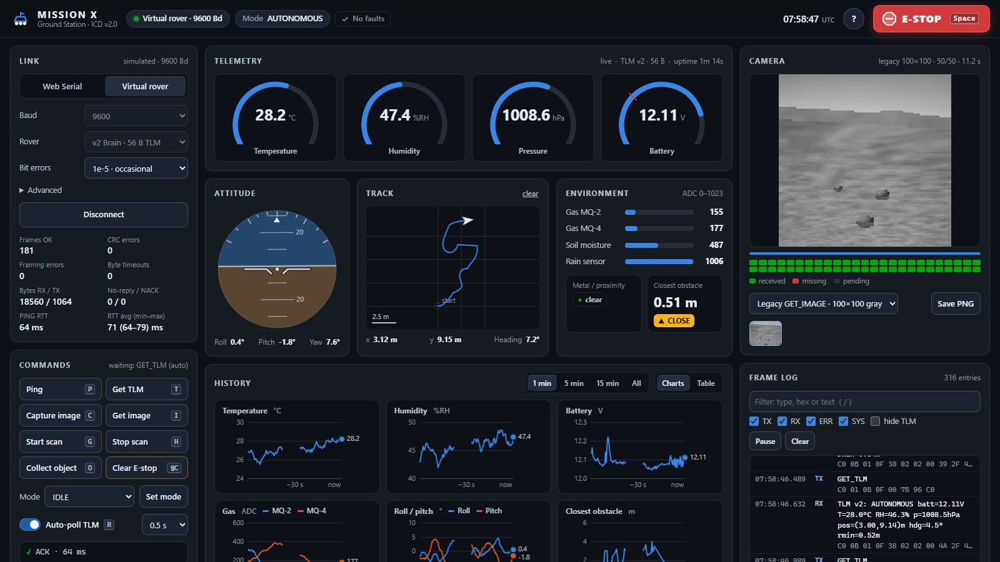

# MISSION X — Ground Station (ICD v2.0)

New ground-station software for the MISSION X six-wheel rover, replacing the lost
2023 Flutter/Firebase app and complementing the 2023 LabVIEW GS (kept as-is):

* **`web/`** — a zero-install browser ground station (Chrome/Edge, Web Serial API).
  No build step, no CDN, no external network, no external fonts: it works offline in the field.
* **`python/`** — command-line tools: `gs_cli.py` (scriptable/interactive GS) and
  `virtual_rover.py` (rover emulator over serial or TCP).
* **`tools/`** — `gen_vectors.py` (Python→JS cross-check vectors) and `bundle_web.py`
  (classic-script build for `file://`).

Everything speaks SSP exactly as specified in [`docs/ICD.md`](../docs/ICD.md): `C0 | DEST SRC TYPE LEN |
DATA | CRC_L CRC_H | C0`, CRC-16/XMODEM low byte first, length-driven receiver with resync,
length plausibility (§3 step 5a) and inter-byte timeout. The Python tools *reuse*
`ros2_ws/src/rover_core` (`rover_core.ssp`, `rover_core.protocol`); the browser codec
(`web/js/ssp.js`, `web/js/protocol.js`) mirrors it line for line and is cross-checked
against it byte for byte.



*`docs/gs_screenshot.png` — 1600×900, built-in virtual rover in autonomous exploration,
0.5 s telemetry polling, legacy 100×100 image downloaded at 9600 Bd (50/50 chunks).*

---

## 1. Web ground station

### Starting it

| How | When |
|-----|------|
| Double-click `web/index.html` (Chrome or Edge) | Field use. Chrome/Edge block ES modules on `file://`, so the page loads the generated classic bundle `web/js/gs-bundle.js` automatically. |
| `python -m http.server 8000 --bind 127.0.0.1 -d web` → open <http://localhost:8000/> | Development; uses the ES modules directly. `localhost` is a secure context, so Web Serial is available. |

Requirements: Chrome or Edge ≥ 89 on Windows/macOS/Linux/ChromeOS (Web Serial). Firefox and
Safari have no Web Serial — the virtual rover still works there over http. Android Chrome only
supports Web Serial on recent versions/devices; a Windows tablet works like a laptop.

### HC-12 radio on a USB-UART adapter

The GS side of link L1 (ICD §1): HC-12 433.4 MHz, channel 001, FU3, 20 dBm, **9600 8N1**.

| USB-UART (CH340 / CP2102 / FT232, 5 V) | HC-12 |
|---|---|
| 5V (VCC) | VCC (3.2–5.5 V; ≥ 200 mA available; add 100–470 µF across VCC/GND near the module) |
| GND | GND |
| TXD | RXD |
| RXD | TXD |
| — | SET: leave unconnected (internal pull-up → transparent mode) |

To (re)configure the module, tie **SET to GND**, open the port at 9600 Bd in any terminal and send
`AT` (→ `OK`), `AT+C001`, `AT+FU3`, `AT+P8` (20 dBm), `AT+B9600`, check with `AT+RX`, then release SET.
The rover side must use the same channel/mode/baud. The HC-12 is half-duplex: the GS therefore keeps
**one request in flight at a time** (see "Command semantics").

### Web Serial permissions

1. Plug in the adapter (Windows may need the CH340/CP210x driver once; Linux: add the user to the
   `dialout` group).
2. **Link → Web Serial → Connect**: the browser shows a port chooser — pick the adapter. The permission
   is remembered per site/file; revoke it in *Settings → Privacy and security → Site settings →
   Serial ports* (or the lock icon in the address bar).
3. Unplugging the adapter is detected (pill turns "Link lost", pending commands fail cleanly).

The baud rate selector (1200…115200, default 9600) must match the HC-12 UART setting.

### Virtual rover (no hardware)

**Link → Virtual rover → Connect** starts a simulated rover inside the page (`web/js/sim.js`, a port of
`python/virtual_rover.py`): skid-steer kinematics, 16 rocks seen by the six ultrasonics (ICD §9.3 poses),
terrain slope → roll/pitch, battery drain with load sag, MQ-2/MQ-4 gas plumes, soil moisture, metal
objects for the proximity sensor, a procedural camera, and a simulated HC-12 link: bytes paced at the
selected baud, ~22 ms air latency, optional bit errors in both directions (1e-5 / 1e-4 / 1e-3).

Rover profiles: **v2 Brain** (56-byte TLM, all commands), **2023 rover** (7-byte TLM, legacy commands
only, silent on v2 commands), **Mega safe-mode link** (PING/GET_TLM/STOP_SCAN/ESTOP/CLEAR_ESTOP, TLM with
fault bit 4).

Demo URL (auto-connect and run a short mission): `index.html?demo&explore=35&poll=0.5&ber=1e-5&win=60`
(`explore` = seconds of autonomous exploration before capture + image download, `poll` = TLM interval,
`ber` = bit error rate, `win` = chart window in seconds).

### What is on screen

* **Header** — link pill (live/quiet/lost), rover mode, decoded fault flags (icon + label), UTC clock,
  big red **E-STOP** (also `Space`).
* **Link** — source, baud, virtual-rover profile and BER, *Advanced* (destination address, reply timeout,
  inter-byte timeout, SLIP transparency), statistics: frames OK, CRC errors, framing errors, inter-byte
  timeouts, bytes RX/TX, unanswered requests / NACKs, last/avg/min/max PING RTT.
* **Commands** — Ping, Get TLM, Capture image, Get image, Start scan, Stop scan, Collect object,
  Clear E-stop, Set mode, auto-poll TLM every 0.5–10 s; the last reply is shown decoded (ACK/NACK
  reason/timeout + round-trip time).
* **Drive** — on-screen pad (press and hold) and `W A S D` / arrow keys; speed and turn sliders. DRIVE is
  refreshed at 4 Hz with a 600 ms duration (rover watchdog) and an explicit `DRIVE 0 0 0` is sent on
  release, on window blur and when the tab is hidden.
* **Telemetry** — temperature, humidity, pressure and battery arc gauges (battery threshold 10.8 V);
  attitude indicator (roll/pitch, +pitch = nose up, +roll = right side down); 2-D track of x/y/heading
  in the map frame; gas MQ-2/MQ-4, soil and rain meters (ADC 0–1023); metal/proximity indicator; closest
  obstacle; uptime and telemetry age. Legacy 7-byte telemetry is shown too (IR, gas, two ultrasonics,
  temperature, humidity).
* **History** — Canvas 2D time-series (temperature, humidity, battery, gas, roll/pitch, closest obstacle)
  with 1/5/15 min/all windows, crosshair tooltips (also keyboard: focus a chart, `←`/`→`), and a
  **Table** view of the samples.
* **Camera** — assembles legacy `GET_IMAGE` (50 × 200 B → 100×100 gray, ~11 s at 9600 Bd) and v2
  `IMAGE_CHUNK` (raw gray8 or JPEG), live progress, chunk map (received / missing / pending), missing
  chunks highlighted in red in the picture, thumbnails, *Save PNG*.
* **Frame log** — every TX/RX frame with time, hex and decoded meaning, decoder errors (CRC, framing,
  timeout) and system messages; filter by text/hex/type and direction, hide TLM polling, pause, click a
  row for a hex dump. *Export TLM CSV* (same columns as `gs_cli.py`), *Save/Load session* (JSON:
  telemetry history, frame log, images, settings).

Keyboard: `Space` E-STOP · `W A S D`/arrows drive · `P` ping · `T` telemetry · `R` auto-poll ·
`C` capture · `I` get image · `G`/`H` start/stop scan · `O` collect · `Shift+C` clear E-stop ·
`M` mode selector · `/` log filter · `?` help.

### Command semantics (GS side)

* One request is outstanding at a time (half-duplex radio); replies are matched by type: PING → ACK,
  GET_TLM → telemetry, CAP_IMAGE/START_SCAN/STOP_SCAN/COLLECT_OBJECT → echo, v2 commands →
  `ACK(type)`, any request → `NACK(type, reason)`.
* **E-STOP bypasses the queue**, cancels queued DRIVE/START_SCAN/COLLECT_OBJECT and is retried up to
  3× until acknowledged; an unacknowledged E-STOP raises an error toast.
* Auto-poll never talks over an image downlink.
* Unsolicited telemetry and image chunks are still decoded and displayed.

---

## 2. Python tools

Requirements: Python ≥ 3.10, `pyserial` (serial links), `Pillow` (PNG/JPEG output). Both scripts put
`ros2_ws/src/rover_core` on `sys.path` (override with `MISSIONX_ROVER_CORE=/path/to/rover_core`).

### Virtual rover

```bash
cd ground_station/python
python virtual_rover.py --tcp 5760                     # v2 Brain on 127.0.0.1:5760
python virtual_rover.py --tcp 5760 --legacy            # 2023 rover: 7-byte TLM, legacy commands only
python virtual_rover.py --tcp 5760 --safe-link         # Mega answering on the HC-12 (ICD §1 L1-safe)
python virtual_rover.py --tcp 5760 --ber 1e-4          # bit errors both ways (--ber-up/--ber-down)
python virtual_rover.py --tcp 5760 --pace 9600         # throttle TCP to HC-12 throughput
python virtual_rover.py --port COM8 --baud 9600        # on a serial port (com0com pair or a 2nd HC-12)
python virtual_rover.py --tcp 5760 --length-check -v   # reject implausible LEN at the header, log frames
```

### Ground-station CLI

```bash
python gs_cli.py --tcp 127.0.0.1:5760 ping                      # PING -> ACK, RTT
python gs_cli.py --port COM7 --ping-test 100                    # RTT min/avg/max/stdev/p50/p95, loss
python gs_cli.py --tcp 127.0.0.1:5760 tlm                       # decoded telemetry (v2 or legacy)
python gs_cli.py --tcp 127.0.0.1:5760 tlm --poll 1 --count 600 --csv tlm.csv
python gs_cli.py --tcp 127.0.0.1:5760 image -o rock.png --capture          # legacy 100x100
python gs_cli.py --tcp 127.0.0.1:5760 image --v2 --quality 60 -o rock.jpg  # v2 IMAGE_CHUNK JPEG
python gs_cli.py --tcp 127.0.0.1:5760 estop                    # also: clear-estop scan-start scan-stop collect cap
python gs_cli.py --tcp 127.0.0.1:5760 mode teleop               # idle|teleop|auto|safe
python gs_cli.py --tcp 127.0.0.1:5760 drive 40 0 1500           # v% w% duration_ms
python gs_cli.py --tcp 127.0.0.1:5760 arm-pose stow             # routed to the arm MCU (0x04)
python gs_cli.py --tcp 127.0.0.1:5760 raw 0x53 02               # any TYPE + hex DATA, decoded reply
python gs_cli.py --tcp 127.0.0.1:5760 -v --retries 2 tlm        # trace every frame (hex + meaning)
python gs_cli.py --tcp 127.0.0.1:5760 --json tlm                # machine-readable output
python gs_cli.py --tcp 127.0.0.1:5760 shell                     # interactive prompt
python gs_cli.py --port COM7 shell < mission.txt                # scripted: one command per line, ';' allowed
```

Exit status: 0 OK, 1 NACK/timeout/incomplete image, 2 usage error, 3 link could not be opened.
`--dest` selects the destination address (rover 0x01 by default), `--timeout`/`--retries` the reply
handling, `--ibt-ms` the inter-byte timeout (default 50 ms on serial, 100 ms on TCP).

The CSV columns are identical in the CLI and the web GS (`time_iso, tlm_version, mode, fault_flags,
battery_V, …, range_min_m, ir, gas_raw, us1_cm, us2_cm`).

---

## 3. Tests

```bash
cd ground_station/web && node --test          # 66 tests: codec, ICD vectors, Python cross-check, GS <-> virtual rover
cd ground_station && python -m pytest          # 47 tests: gs_cli <-> virtual_rover over TCP, every command, images, BER
```

* `web/test/ssp.test.mjs` — the four ICD §2.1 vectors, CRC check value, random round trips
  (transparency off/on), flags inside payload, shared flags, CRC error recovery, dropped-byte and
  false-sync resynchronisation (with and without length check), inter-byte timeout, address filter.
* `web/test/crosscheck.test.mjs` — replays `web/test/test_vectors.json` (written by
  `tools/gen_vectors.py` from `rover_core`): CRCs, encodings, 16 corrupted streams (dropped bytes,
  bit flips, inserted noise, late start, 0xC0-rich image payloads, SLIP, timeouts with explicit
  timestamps, address filter) — the JS decoder must return exactly the frames **and statistics** of
  the Python `StreamDecoder` — plus every payload struct, `SetVelocity.from_si` rounding and the full
  `plausible_length` table.
* `web/test/gs_sim.test.mjs` — the browser GS core against the JS virtual rover (no DOM).
* `python/tests/` — `gs_cli` logic against `virtual_rover` in-process over a local TCP socket:
  every legacy and v2 command, NACK reasons, routed MCU frames, legacy/safe-link profiles, SLIP,
  ping statistics, CSV polling, uplink/downlink bit errors with retries, image download with bit errors
  (received chunks must land in the right slot), CLI entry points and scripted shell; plus freshness
  checks for `test_vectors.json` and `gs-bundle.js`.

After changing `rover_core` run `python tools/gen_vectors.py`; after changing `web/js/*.js` run
`python tools/bundle_web.py` (the tests fail if either generated file is stale).

---

## 4. Compatibility

* **The 2023 LabVIEW GS keeps working** with v2 rovers for the legacy command set: flags, header
  order, CRC algorithm and CRC byte order are unchanged (ICD §2), PING still returns a LEN 0 ACK and
  CAP_IMAGE/START_SCAN/STOP_SCAN/COLLECT_OBJECT still echo. It was built for the legacy telemetry
  layouts, so it does not know the **56-byte v2 telemetry** the Brain returns to GET_TLM, and it has no
  v2 commands (E-STOP, SET_MODE, DRIVE, …) — **v2 telemetry and commands need the new GS** (web or CLI).
* The new GS talks to **legacy rovers** too: telemetry layout is detected by length/version byte,
  legacy images are assembled without sequence numbers, and v2 commands simply time out.
* SLIP transparency is off by default on every link (as in the ICD); enable it on both ends if used.

## 5. ICD interpretations made here

| Topic | Interpretation |
|---|---|
| `GET_IMAGE` v2 `quality` | 0 → raw gray8 100×100 in IMAGE_CHUNK (fmt 0); 1–100 → JPEG at that quality (fmt 1; the virtual rovers send 160×120). |
| IMAGE_CHUNK payload offset | `seq × 200` (every chunk but the last carries 200 B). |
| Lost legacy chunks | Legacy chunks have no sequence number; each is exactly 208 B on the wire, so the GS infers how many chunks were lost from the bytes consumed between two valid chunks (CLI and web), instead of shifting the rest of the picture. |
| Reply matching | One outstanding request (half-duplex); replies matched by type, SRC not required to equal DEST (the Mega answers as 0x02 in safe mode). An ACK with LEN 0 is accepted as positive reply. |
| ACK payload | PING → ACK LEN 0 (legacy compatible); v2 commands → ACK with 1 B = acknowledged type. |
| Invalid SET_MODE value | NACK reason 4 (not permitted) — the ICD has no "bad value" reason. |
| DRIVE | ±100 % ↦ 0.45 m/s / 1.0 rad/s (`rover_core.params` limits); first DRIVE in IDLE switches to TELEOP; NACK 3 (busy) in AUTONOMOUS or during COLLECT_OBJECT, NACK 4 while e-stopped; SAFE mode limits to 30 %; expiry of a non-zero DRIVE sets fault bit 1 until the next DRIVE/mode change. |
| E-stop | ESTOP latches, stops motors and sets mode IDLE; CLEAR_ESTOP releases the latch (mode stays IDLE). |
| Safe-mode link | Answers PING/GET_TLM/STOP_SCAN/ESTOP as listed in ICD §1 **plus CLEAR_ESTOP** (otherwise a latched e-stop could not be released over the radio); others → NACK 4; source address 0x02. |
| Attitude signs | +pitch = nose up, +roll = right side down (not specified in the ICD). |
| `yaw` vs `heading` | Both shown: `yaw` (IMU, drifts) and `heading` (map frame). |
| Inter-byte timeout | ICD 50 ms on serial (CLI); the browser defaults to 100 ms because Web Serial delivers bytes through a JS event loop whose jitter can exceed 50 ms (50 ms selectable under *Advanced*). |
| Length check (§3 step 5a) | Enabled in both ground stations (non-strict). The virtual Brain leaves it off by default so it can NACK bad lengths (`--length-check` to enable). |
| Legacy gas | `gas_raw = (gas_hi << 8) + gas_lo` as in `rover_core.protocol` (the ICD example decodes to 0x8700). |

## 6. Files

```
ground_station/
├── README.md                     this file
├── pytest.ini
├── docs/gs_screenshot.png        dashboard screenshot (headless Chrome, 1600x900, ?demo mode)
├── web/
│   ├── index.html                single page (loads modules over http, gs-bundle.js on file://)
│   ├── css/gs.css                dark mission-control theme (responsive, no external fonts)
│   ├── js/ssp.js                 CRC-16/XMODEM, Frame, encode, StreamDecoder (mirror of rover_core.ssp)
│   ├── js/protocol.js            addresses, types, payload structs, plausibleLength, decodeTlm, CSV
│   ├── js/gs.js                  GS core: queue, matching, telemetry, image assembly, log, session
│   ├── js/sim.js                 virtual rover + simulated HC-12 link
│   ├── js/serial.js              Web Serial link
│   ├── js/widgets.js             Canvas 2D gauges, charts, attitude indicator, track plot
│   ├── js/app.js                 UI wiring
│   ├── js/gs-bundle.js           GENERATED classic-script bundle (tools/bundle_web.py)
│   ├── package.json              {"type": "module"} + "test": "node --test" (no dependencies)
│   └── test/                     node --test suites + test_vectors.json (GENERATED)
├── python/
│   ├── gs_cli.py                 CLI ground station (serial / TCP)
│   ├── virtual_rover.py          rover emulator (serial / TCP)
│   ├── gs_common.py              rover_core path setup, frame descriptions, CSV schema
│   └── tests/                    pytest suites
└── tools/
    ├── gen_vectors.py            Python -> JS cross-check vectors
    └── bundle_web.py             ES modules -> classic bundle for file://
```

The screenshot was produced with the page's demo mode:
`chrome --headless=new --window-size=1600,900 --force-device-scale-factor=1 --virtual-time-budget=75000
--screenshot=docs/gs_screenshot.png "http://localhost:8000/?demo&explore=35&poll=0.5&ber=1e-5&win=60"`.
